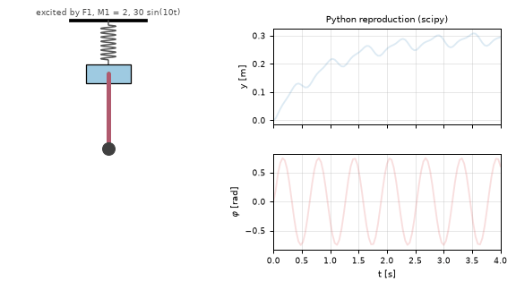
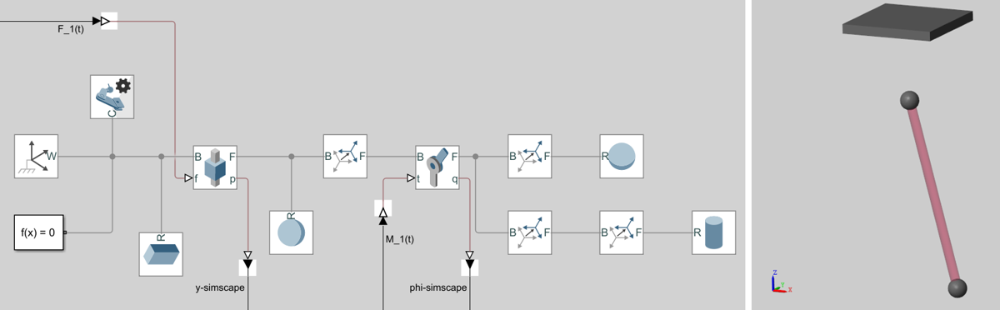
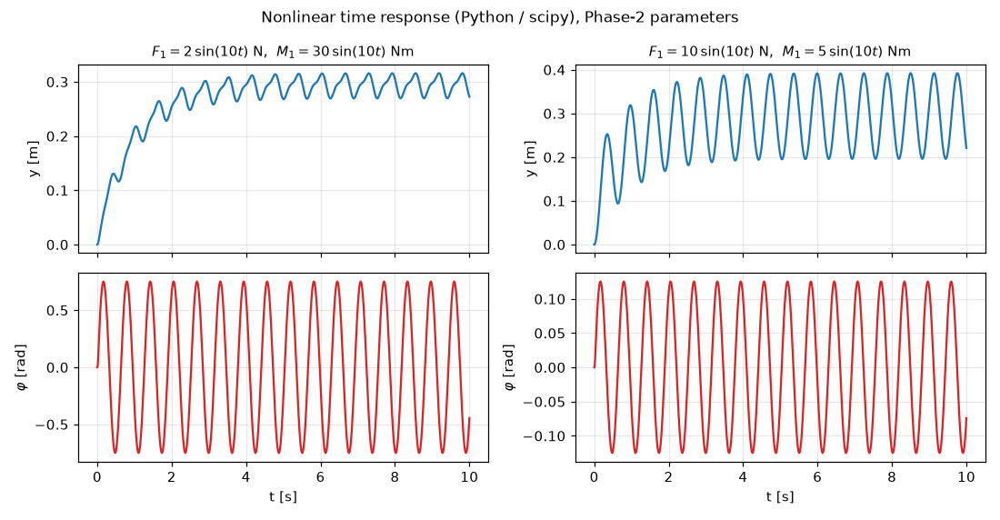
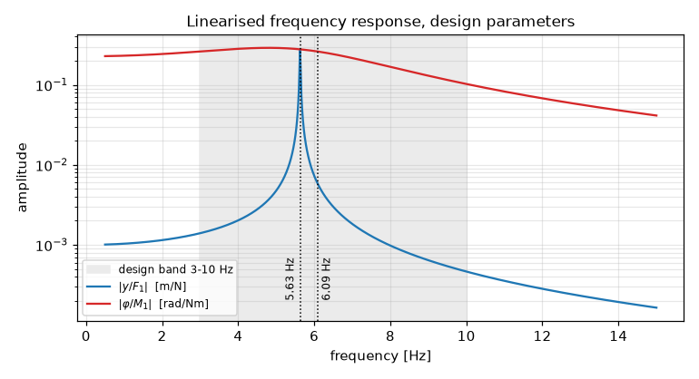

# Pendulum on a spring-suspended mass: 2-DOF multibody model

A 2-degree-of-freedom oscillator, modelled from first principles and checked three ways: symbolic equations of motion (Newton–Euler **and** Lagrange), a hand-built Simulink block diagram, and a Simscape Multibody model. Course project in *Modelling & Simulation / Multibody Systems*, M.Sc. Mechatronics/Robotics, FH Technikum Wien (summer 2021, lecturer A. Mario Puhwein). This repo also has a Python re-implementation (sympy + scipy) that reproduces the original MATLAB results.

<p align="center"></p>

## The system

A carrier mass `m2` hangs from a spring–damper (`k`, `c`) and moves vertically (`y`, positive downwards). A pendulum is hinged to it: a uniform rod (`m1`, `l1`) with a tip mass `m3`, a torsional spring–damper at the hinge (`kφ`, `cφ`), and angle `φ` from the vertical. Inputs are a force `F1(t)` on the carrier and a torque `M1(t)` at the hinge.

With $m_s = m_1/2 + m_3$, $m_{ges} = m_1+m_2+m_3$ and $J_A = l_1^2(m_1/3 + m_3)$, both methods give

$$m_{ges}\,\ddot y + c\dot y + k y - m_s l_1\left(\dot\varphi^2\cos\varphi + \ddot\varphi\sin\varphi\right) = F_1(t) + m_{ges}\,g$$

$$J_A\,\ddot\varphi + c_\varphi\dot\varphi + k_\varphi\varphi + m_s l_1\,(g - \ddot y)\sin\varphi = M_1(t)$$

The two coordinates are coupled through the inertial terms. Linearised about the rest position ($\varphi = 0$, $y_0 = m_{ges}g/k$), they decouple, giving

$$f_y = \frac{1}{2\pi}\sqrt{\frac{k}{m_{ges}}}, \qquad f_\varphi = \frac{1}{2\pi}\sqrt{\frac{k_\varphi + m_s g l_1}{J_A}}$$

## What was done

| Phase | Content | Files |
|---|---|---|
| 1 | Equations of motion by Newton–Euler (free-body diagrams) and by Lagrange 2nd kind, checked against each other in the MATLAB Symbolic Toolbox; rest positions, linearisation, matrix form `M q̈ + C q̇ + K q = F`, state space, symbolic Jacobians `∂f/∂x`, `∂f/∂u` | [`matlab/phase1_equations/`](matlab/phase1_equations) |
| 2 | Same model as a Simulink block diagram (integrator chains) and as a Simscape Multibody model (prismatic + revolute joint, brick/sphere/cylinder solids); both driven by `F1 = F0 sin(10t)`, `M1 = M0 sin(10t)` and compared | [`matlab/phase2_simscape/`](matlab/phase2_simscape) |
| 3 | Parameter design so that both modes lie in the 3–10 Hz band; frequency response / Bode plot | report |
| – | **Python reproduction** (this repo, 2026): sympy derivation, scipy simulation, eigenfrequencies, figures | [`python/`](python) |

<p align="center"><br><sub>The group's Simscape Multibody model (left) and its Mechanics Explorer view (right). Spring and damper sit inside the joint blocks, so they aren't drawn.</sub></p>

## Results (Python reproduction vs. original)

`python/model.py` re-derives the equations with sympy's Lagrange formalism. It then checks symbolically that they are **identical** to the group's equations (report eqs. 60/61, the Simulink model). `python/simulate.py` integrates the nonlinear model with `solve_ivp`, using the same excitation and Phase-2 parameters as `simscape.slx` (`m1 = m2 = m3 = 0.1 kg`, `l1 = 0.2 m`, `k = 10 N/m`, `c = 10 Ns/m`, `kφ = 40 Nm/rad`, `cφ = 0.4 Nms/rad`).



| Run | Report (Simulink = Simscape) | Python |
|---|---|---|
| `F0 = 2 N, M0 = 30 Nm` | φ ≈ ±0.75 rad, y ≈ 0.27–0.31 m | φ = ±0.751 rad, y = 0.268–0.316 m |
| `F0 = 10 N, M0 = 5 Nm` | φ ≈ ±0.125 rad, y ≈ 0.19–0.39 m | φ = ±0.125 rad, y = 0.195–0.392 m |

**Design parameters** (Phase 3: `m1 = 0.6 kg`, `m2 = m3 = 0.1 kg`, `l1 = 0.1 m`, `k = 1000 N/m`, `c = 0.1 Ns/m`, `kφ = 4 Nm/rad`, `cφ = 0.1 Nms/rad`): the linearised eigenfrequencies are **5.63 Hz** (vertical) and **6.09 Hz** (pendulum), both inside the 3–10 Hz target band. The report gives a single "system frequency" of 5.8 Hz, which falls between the two. Its frequency-response peak is at about 5.6 Hz, the vertical mode.



**Notes from the reproduction**
- `Jacobian.mlx` has `y_dot^2*cos(varphi)` where the equation (and the Simulink model) has `varphi_dot^2*cos(varphi)`. The printed Jacobian in the report inherits this typo. It doesn't affect the linearisation, because all velocities are zero at the rest position.
- In `Mechanical_Equations.mlx` the potential energy uses `+l1 g cos θ (m1/2+m3)`. The report's derivation (eq. 33) uses `+l1 g (1−cos θ)(m1/2+m3)`, which gives the restoring `+m_s g l1 sin φ` term that the final equations contain. `python/model.py` builds V from the heights directly.
- The Simulink/Simscape excitation is `sin(10t)`, while the plot titles in `simscape_variables.m` say `cos`.

## How to run

```bash
pip install -r requirements.txt
cd python
python model.py      # symbolic derivation, check vs. group's equations, state space, eigenfrequencies
python simulate.py   # writes docs/time_response.png, docs/frequency_response.png, docs/pendulum_spring.gif
```

MATLAB (R2020b, Symbolic Math Toolbox, Simulink, Simscape Multibody): open the `.mlx` live scripts in `matlab/phase1_equations/`. For Phase 2, run `matlab/phase2_simscape/simscape_variables.m` up to the parameter block, simulate `simscape.slx`, then run the rest of the script to plot Simulink against Simscape.

## Team & my contribution

Group project by **Abdulhamid Baghdadi, Markus Keck and Leopold Maurer** (group E). The three of us did the derivation, the Simulink/Simscape models, the parameter design and both reports together (the Phase-1 live script lists Baghdadi and Keck as its authors). The final report is *"Aufbau eines 2-Massenschwingermodells"* (2021). It isn't included here because it contains course-provided figures and student IDs. The Python reproduction and this write-up were added by Abdulhamid Baghdadi in 2026. The course task and lecture material belong to FH Technikum Wien and aren't included.
